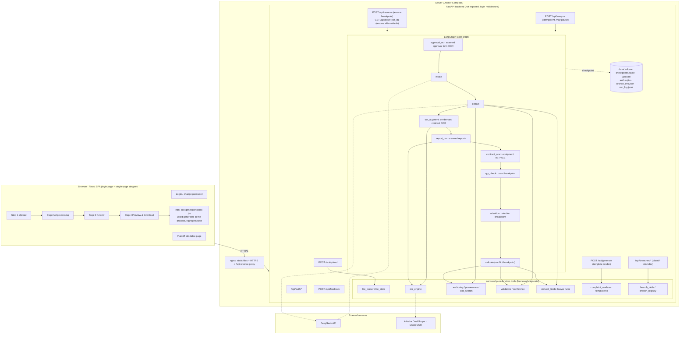
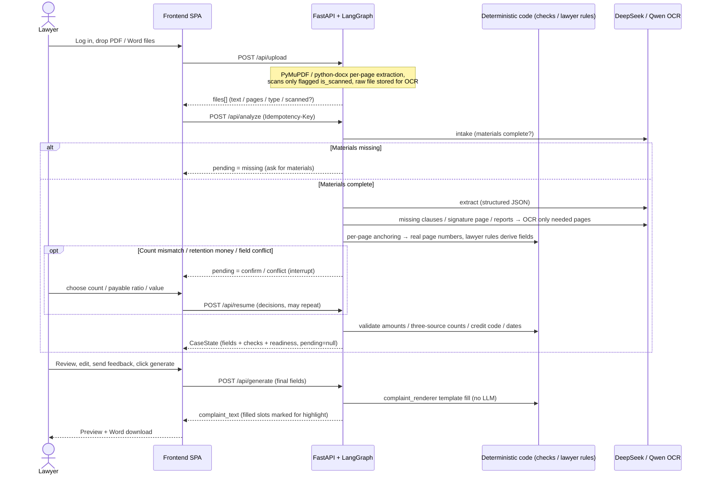

# Complaint Assistant · Elevator Installation-Contract Dispute Automation (v2)

**English** | [中文](./README.zh-CN.md)

A web app for legal teams. Lawyers upload case materials: approval forms, installation or sales contracts, and elevator supervision inspection reports. An agent then does several things:

- checks the materials in, extracts fields, and cross-validates them;
- applies the lawyer-confirmed drafting rules to derive the plaintiff, elevator counts, penalties and the competent court.

After the lawyer reviews and confirms, the app generates a civil complaint as a Word document in one click, with the filled-in text highlighted in yellow for a final check. If the contract specifies arbitration, it generates an arbitration application instead.

> **v1 → v2**: v1 was a fixed pipeline (`upload → checklist → extract → validate → generate`) with hard-wired control flow. v2 makes the core **agentic**. A tool-equipped LangGraph agent drives the control flow, OCRs only the scanned pages it needs, self-checks with deterministic code, and pauses at key disagreements to ask the lawyer (human-in-the-loop).
>
> **Current status**: deployed for lawyer trials (UAT), to validate AI extraction accuracy and the lawyer experience. The site has a Chinese login page, admin-created accounts and HTTPS. Case state is stored in a local SQLite database, so review can resume after a restart, and it is purged automatically after 7 days.

## At a glance

### Architecture

- **Three layers.** A React single-page app (upload → processing → review → preview) talks to a FastAPI backend. The backend runs a LangGraph agent, and the agent calls framework-agnostic tools in `backend/app/services/`.
- **Agent graph.** One case runs through a fixed set of nodes:
  1. `approval_ocr`: OCR a scanned approval form.
  2. `intake`: check which materials were uploaded. This is plain code.
  3. `extract`: the LLM extracts fields as structured output.
  4. `ocr_augment`, `report_ocr`, `contract_scan`: OCR scanned contracts and reports page by page, stopping once the needed clauses are found.
  5. `qty_check`, `retention`, `validate`: lawyer breakpoints.

  Each breakpoint is a LangGraph `interrupt`. The case state is checkpointed to SQLite, so the lawyer can answer, refresh or come back later, and the agent resumes from the same point.
- **Division of labour.** The LLM only reads values and clause text out of the materials. Deterministic Python code does everything else:
  - matching each value back to its source page;
  - reconciling amounts and elevator counts;
  - applying the lawyer-confirmed drafting rules;
  - filling the complaint template.

  The frontend turns the filled template into a Word file.
- **External services.** DeepSeek is the LLM, with Qwen as the fallback. Qwen multimodal via DashScope does the OCR. API keys stay on the server.

Details: [System architecture](#system-architecture) and [Data flow](#data-flow-agent-session--human-in-the-loop).

### Evaluation

- **Real cases.** `backend/scripts/eval_cases.py` runs the full pipeline, without the browser, on real cases whose complaints a lawyer has already written. It scores the result field by field. The latest run got 164 of 165 fields right. Real cases stay on the server and are never committed.
- **Synthetic cases in CI.** Every pull request replays six fully synthetic cases in [`backend/eval_fixtures/`](./backend/eval_fixtures/README.md), using recorded OCR and LLM responses, so it needs no network and costs nothing. The job fails if any field gets worse against the committed baseline, or if a change sends a request that was never recorded.
- **Beyond accuracy.** Reports also count:
  - fields taken from the wrong source file;
  - *silent errors*: wrong values that the review page shows as normal.

  Each wrong or missing field is also attributed to a cause, using only the recorded OCR text:
  - extraction error;
  - suspected OCR misread;
  - page never OCR'd;
  - value not from OCR;
  - rule-derived wording.

  The cause shows whether to work on OCR or on extraction next.

Details: [Evaluation](#evaluation).

---

## Core principles

- **AI never makes the final call.** The agent only extracts, validates and proposes; the lawyer confirms and edits. It pauses to ask at key disagreements:
  - conflicting fields;
  - mismatched elevator counts;
  - the retention-money ratio.

  Missing materials are flagged on the upload page instead: the lawyer can add files or choose to continue with what was uploaded.
- **Validation is code, not LLM.** Deterministic Python handles amount reconciliation, the three-source quantity comparison, format checks, and the calculations in the lawyer rules (penalty amount, start date, court name, etc.). The LLM only pulls out the numbers and the clause text.
- **Traceable provenance.** Every field value is tagged with its source file and a **verified page number** found by per-page anchoring, never one the LLM reports itself.
- **A gap beats a fabrication.** Uncertain fields are marked missing and never invented. A value that does not anchor back to the source is flagged "to verify", both on the review page and in the complaint.
- **Template rendering, not free generation.** The complaint is filled deterministically from structured fields into the lawyers' template. The LLM never writes the full text.

---

## Features

| Feature | Details |
|---|---|
| Material parsing | Text PDFs, Word files and scanned PDFs (≤ 20 MB each, ≤ 95 MB per upload). Scans are never OCR'd whole: the agent reads only the pages it needs (payment / breach / dispute clauses, signature page, equipment list, acceptance reports) and stops once it finds them, capped at 50 pages of scanned contracts and 30 pages of scanned acceptance reports per case. A scan whose file name gives no type has only its first page OCR'd to read the title. |
| Material confirmation | After upload, each file shows its detected type (approval form / contract / supplementary agreement / acceptance report / strategic or framework contract). The lawyer can correct it from a dropdown, and the missing-materials check is recomputed. |
| Extraction & anchoring | Structured fields are read straight from the approval form, and contract clauses are kept verbatim. Each value is matched back to the source page by page; values with no match are flagged "to verify". |
| Cross-validation | Amount reconciliation (total = paid + unpaid), elevator counts across signing / contract / acceptance, credit-code check digit, dates. |
| Lawyer drafting rules | Several rounds of lawyer-confirmed rule sheets, implemented as code in `services/derived_fields.py` and `services/payment_nodes.py`. They cover:<br>• plaintiff naming (HQ + branch, or an independent subsidiary)<br>• sales vs. installation wording<br>• elevator-count basis (including VGE home elevators)<br>• citing the payment milestones the debt falls under (matched by the cumulative ratio of paid + unpaid)<br>• supplementary agreements and strategic / framework contracts (clauses only)<br>• penalty vs. late-payment interest (rate-based, lump-sum, fixed daily amount, caps)<br>• paid / unpaid ratios<br>• competent court and jurisdiction sentence<br>• switching to an arbitration application |
| Lawyer breakpoints | Pauses on field conflicts, count mismatches, and contracts with retention money (the lawyer picks "paid up to X% of the contract price"). It resumes once the lawyer decides. |
| Review page | A Chinese field table with status, source and page, grouped into parties / contract & amounts / payment & breach clauses / jurisdiction & document, with a "needs attention only" filter. Every field is editable, and each field has a button for submitting feedback on it. Edits survive going back from the preview; the browser asks before a refresh, and after one the lawyer can resume the previous case. |
| Complaint export | The preview shows how many blanks still need filling. The Word export keeps the yellow highlights for a final check. |
| Plaintiff info table | A firm-wide table of plaintiff credit codes, legal representatives and addresses. Anyone can view or download it as Excel; uploading a new version or restoring an old one needs the admin token. |
| Login | Accounts are created by an admin on the server (there is no sign-up). Sessions last 7 days, lawyers can change their own password, and repeated wrong passwords lock the login. |
| Operations | The run log records field keys, timings, tokens and account names, never case content. On top of it:<br>• usage per account, and a list of lawyer feedback<br>• cost per case / node / model (from configured unit prices), fixed error categories, how long lawyers wait at breakpoints and how often they abandon<br>• a daily summary written on the server, with alerts when thresholds are crossed (failed analyses, OCR failure rate, model fallbacks, paid-key use, key connectivity)<br>• browser errors and API 5xx reported from the frontend (error type and step only, never the message text)<br>GitHub Actions deploys after approval. Health checks are split into liveness (`/healthz`) and readiness (`/readyz`: database read/write, free disk, keys configured), and a deploy that is not ready rolls back automatically. |

---

## Tech stack

| | |
|---|---|
| Frontend | React 19 + Vite + TypeScript (strict) + Tailwind CSS + shadcn/ui + react-hook-form/zod + docx-js |
| Backend | FastAPI (Python 3.10+) + PyMuPDF (PDF) + python-docx (Word) |
| Agent orchestration | LangGraph (state graph + `interrupt` breakpoints + SQLite checkpoint; graph and checkpoints only, no full LangChain) |
| OCR | Qwen multimodal via Alibaba Cloud DashScope (international), default `qwen3.8-flash`, with an optional paid backup key |
| LLM | DeepSeek API (`deepseek-flash`, via the OpenAI SDK with structured output) |
| Deployment | Docker Compose (backend + nginx), Let's Encrypt HTTPS, GitHub Actions auto-deploy after approval |

---

## Material types and source reliability tiers

A typical case has three material types that differ greatly in form and reliability, so the agent treats them differently:

| Material | Form | Reliability | Agent strategy |
|---|---|---|---|
| **Approval form** | Parseable text, key–value form | ⭐⭐⭐ highest | **Primary source**: contract type, contracting branch, defendant name, contract no., counts, amounts and contacts are read directly. The defendant's address and legal representative come from the business registry, not from this form. |
| **Acceptance / inspection reports** | Parseable text + stamp image; often phone-photo scans | ⭐⭐ medium-high | **Cross-check source**: credit code, installation site, approval date (latest batch), elevator count (one per report front page). Scanned reports are OCR'd on demand. |
| **Installation / sales contract** | Often a pure scan (needs OCR) | ⭐ noisy | **Clause source**: payment, breach, retention-money and dispute clauses, plus the signature page and equipment list. Only relevant pages are read, and reading stops once the clause is found. |

---

## System architecture



---

## Data flow (agent session + human-in-the-loop)



---

## Deterministic validation and layered confidence

- **Validation (code, not LLM)**: `validators.py` runs the checks below. Their results are the only authority for the "conflict" status on the review page.
  - Amount reconciliation, with a one-cent tolerance.
  - Three-source elevator count. When the acceptance reports give a count, that count wins, and a mismatch is flagged for the lawyer without pausing.
  - 18-digit credit-code check digit.
  - Date validity.
- **Layered confidence**:
  - Hard signals set the status: normal / missing / conflict / to verify.
  - Soft signals give a `confidence` score from 0 to 100, used only to sort the review page and decide which fields start expanded. It is computed as `channel×40 + anchoring×30 + self-consistency×20 + model self-rating×10`.
- **Complaint readiness**: the share of template blanks that have a value and no conflict. It uses the same count as the preview's "N blanks left", and turns green only at 100%.

---

## Project structure

```
legal-doc-gen/
├── CLAUDE.md                        # Instructions for AI coding assistants (full spec + lawyer rules)
├── README.md / README.zh-CN.md      # This file (English / Chinese)
├── prompts/                         # LLM prompts and the complaint template
│   ├── prompt-a-extract.md          # Field extraction (structured)
│   ├── prompt-a-clauses.md          # Clause extraction from scanned contracts
│   ├── prompt-a-validate.md         # Highlight text only (no consistency judgments)
│   └── complaint-template.md        # Complaint template (placeholders)
│
├── frontend/                        # React frontend
│   └── src/
│       ├── components/{auth,upload,processing,review,preview,branches,layout,ui}/
│       ├── hooks/{useAuth,useComplaintFlow,useAdminToken,useLeaveWarning}.ts
│       └── lib/{api,auth-api,branch-api,buildReviewFields,case-session,field-groups,field-map,
│               html-doc-generator,materials,request-key,types,upload-limits}.ts
│
├── backend/                         # Python FastAPI backend
│   ├── app/
│   │   ├── main.py  config.py
│   │   ├── routers/{auth,files,analyze,resume,generate,branches,feedback,extract}.py
│   │   ├── agent/{graph,state,nodes,runner,checkpoint}.py    # LangGraph graph + SQLite checkpoint
│   │   └── services/                                         # Framework-agnostic pure-function tools
│   │       ├── file_parser  file_store  ocr_engine  llm_client  prompt_loader
│   │       ├── extraction  anchoring  provenance  doc_search  validators  confidence
│   │       ├── derived_fields  payment_nodes  acceptance_report  equipment_list  complaint_renderer
│   │       ├── branch_table  branch_registry  company_lookup (placeholder)
│   │       └── auth_store  login_guard  run_log  progress_table  llm_progress  upload_progress
│   ├── scripts/{manage_users,list_feedback,usage_report,cost_report}.py  # Accounts / feedback / usage / cost & errors
│   ├── scripts/eval_cases.py + case_eval/                    # Case eval: per-field scoring on real cases (kept out of the repo)
│   └── tests/                                                # pytest (synthetic data)
│
├── deploy/                          # nginx config, cert.sh, deploy.sh, deployment guide (Chinese)
├── docker-compose.yml
└── .github/workflows/{ci,deploy}.yml
```

`POST /api/extract` and `GET /api/extract/progress` in `routers/extract.py` are v1 leftovers the frontend no longer calls; analysis progress comes from `GET /api/analyze/progress`.

---

## Local development

```bash
# 1. Start the backend
cd backend
pip install -r requirements.txt
cp .env.example .env       # fill in DEEPSEEK_API_KEY and DASHSCOPE_API_KEY
uvicorn app.main:app --reload --port 8000

# 2. Start the frontend
cd frontend
pnpm install
pnpm dev                   # http://localhost:5173, /api/* proxied to :8000
```

Login is off by default in local development (`AUTH_ENABLED=0`). Case data is stored under `backend/data/`.

Checks and tests:

```bash
cd backend && python -m ruff check . && python -m pytest
cd frontend && pnpm lint && pnpm test && pnpm build
```

## Evaluation

Unit tests check each rule in isolation. To see how the whole system does on real cases, `backend/scripts/eval_cases.py` runs it end to end on cases where a lawyer has already written the complaint, and scores it field by field against that complaint.

- **How it scores**: each field is correct, wrong, missing (it would show as "to be filled" in the complaint), or pending (the lawyer has not yet confirmed the rule; listed but not scored). Fields are compared, not whole sentences, because lawyers word complaints differently.
- **Source and silent errors**: an expected field can also name the file it should come from. The value is matched back to the materials with the same logic the app uses, so the source is judged by where the value is actually found, not by where the model says it came from. A *silent error* is a field the review page shows as normal even though it is wrong, should have been flagged for review, or cannot be found in the materials. These are the dangerous ones, so they are counted separately.
- **Free reruns**: OCR and LLM responses are recorded per case, keyed by the request. After a rule change, `--strict` replays the recordings at no cost and without network access; after a model or prompt change, `--mode live` re-records them. Each run is compared field by field with the previous one.
- **Where the cases live**: real cases contain client information, so they stay on the server under `/srv/eval-cases` and are never committed (see [deploy/README.md](./deploy/README.md)).
- **Latest result** (real-case set, October 2026): 164 of 165 scored fields correct (about 99%). The one error is a clause number misread by OCR; by design the system does not silently correct OCR text, and it marks scanned values for the lawyer to verify.
- **Synthetic case set in CI**: [`backend/eval_fixtures/`](./backend/eval_fixtures/README.md) holds six fully synthetic cases (scanned contract read on demand, retention-money breakpoint, a strategic agreement with an arbitration clause, VGE home elevators, a lump-sum penalty, several jurisdiction rules, plus two cases with deliberate errors that pin down error attribution) with their recorded responses. Every pull request replays them strictly in CI and compares each field with a committed baseline. The job fails, naming the case and field, if any field gets worse or if a change makes the system send a request that was never recorded (for example after a prompt edit); the message gives the command to re-record. It needs no API keys and runs in seconds.

## Deployment (UAT / production)

- **How**: `docker compose up -d --build` starts everything in one go: nginx, HTTPS, login and the case-data volume.
- **Auto-deploy**: after a merge to master passes CI and an admin approves it on GitHub, the server is updated automatically. A failed deploy rolls back.
- **Full steps**: accounts, certificates, backups, and how to read feedback and usage reports are in [deploy/README.md](./deploy/README.md), which is in Chinese.

> Security conventions: API keys live only in the server's `backend/.env`, never in git. Real case files are never committed; all tests use synthetic data.

---

## Migration progress (v1 pipeline → v2 agentic)

| Step | Content | Status |
|---|---|---|
| 1–2 | Tool layer (validators / confidence / anchoring) + unit tests | ✅ |
| 3 | Cross-validation moved out of the LLM into deterministic code | ✅ |
| 4 | Complaint rendered by template fill (no LLM free generation) | ✅ |
| 5 | Agent orchestration (LangGraph + interrupt, frontend and backend) | ✅ |
| 6a | Traceable provenance (real page numbers via per-page anchoring) | ✅ |
| 6b | On-demand OCR (scanned contracts and reports read page by page, stopping once found) | ✅ |
| 7 | Online company lookup: interface in place, lookup API not yet connected. Lawyers currently enter registry details on the review page. | 🚧 |
| — | Go-live: login, SQLite persistence with expiry, Docker + HTTPS, auto-deploy | ✅ |

---

## Out of scope (future iterations)

Permission levels (all accounts currently have the same rights; updating the plaintiff table separately needs the admin token), batch processing, vector search, full LangChain, etc. See [CLAUDE.md](./CLAUDE.md).
