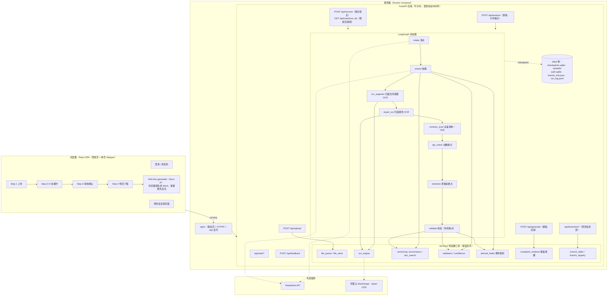
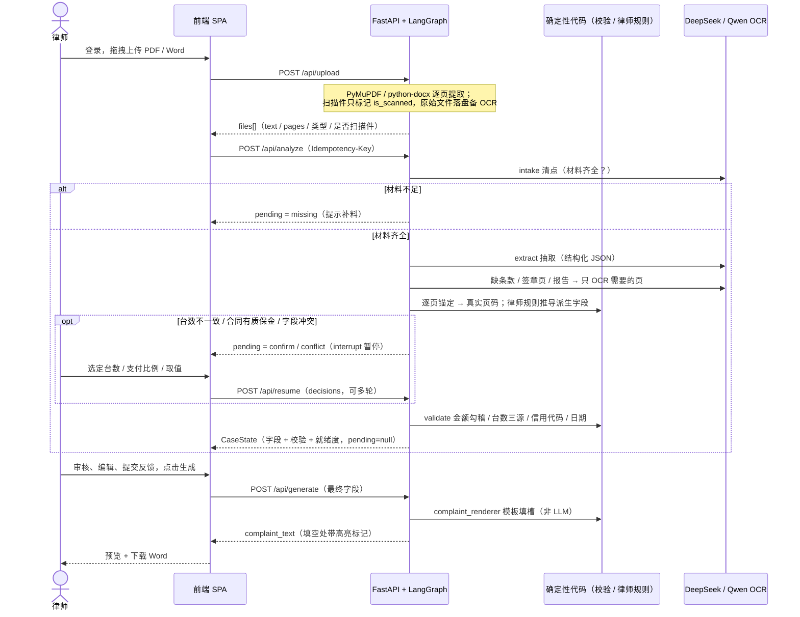

# 起诉状助手 · 安装合同纠纷起诉状自动化系统（v2）

[English](./README.md) | **中文**

面向律师团队的 Web 应用：律师上传案件材料（审批表、安装 / 买卖合同、电梯监督检验报告等），agent 自动完成材料清点、字段抽取、交叉校验，并按律师确认过的填写规则推出原告、台数、违约金、管辖法院等内容；律师审核确认后，一键生成带黄色复核高亮的民事起诉状（约定仲裁时为仲裁申请书）Word 文档。

> **v1 → v2**：v1 是固定流水线（`upload → 清点 → 抽取 → 校验 → 生成`，控制流写死）。v2 将核心处理改为 **agentic**：由带工具的 LangGraph agent 驱动控制流，按需 OCR 扫描页，用确定性代码自校验，在关键分歧点暂停问律师（human-in-the-loop）。
>
> **当前状态**：已部署上线供律师试用（UAT），用于验证 AI 抽取准确率和律师使用体验。站点有中文登录页，账号由管理员创建，走 HTTPS。案件状态存在本机 SQLite 里，服务重启后可以接着审核，超过 7 天自动清除。

---

## 核心原则

- **AI 不做最终判断**：agent 只抽取、校验、提议，由律师确认和修改。材料缺失、字段冲突、台数对不上、质保金比例等关键分歧点，agent 暂停问律师。
- **校验用代码，不用 LLM**：金额勾稽、台数三源比对、格式校验，以及律师规则里的推算（违约金金额、起算日、法院名称等），一律由确定性 Python 代码完成。LLM 只负责把数字和条款原文抽出来。
- **出处可追溯**：每个字段值都标注来源文件，以及逐页锚定得出的**已验证真实页码**，不用 LLM 自己报的页码。
- **宁缺勿造**：无法确定的字段标为缺失，绝不编造。回原文比对没命中的值标「待核实」，审核页和起诉状里都会提醒律师。
- **模板渲染，不自由生成**：起诉状由结构化字段加律师模板确定性填槽，LLM 不写全文。

---

## 主要功能

| 功能 | 说明 |
|---|---|
| 材料解析 | 可解析 PDF、Word、扫描件 PDF（单个 ≤ 20 MB，一次合计 ≤ 95 MB）。扫描件不整份 OCR，agent 只读需要的页（付款 / 违约 / 争议条款、签章页、设备清单、验收报告），找到即停，单案扫描合同最多 50 页、扫描验收报告最多 30 页；文件名认不出类型的扫描件只识别第 1 页标题 |
| 材料确认 | 上传后逐份显示系统识别的类型（审批表 / 合同 / 补充协议 / 验收报告 / 战略或框架合同），认错可下拉改，按改后的类型重算缺哪些材料 |
| 字段抽取与锚定 | 审批表结构字段直取，合同条款原文保留。抽取值回原文逐页命中，没命中的标待核实 |
| 交叉校验 | 金额勾稽（总额 = 已付 + 未付）、签约 / 合同 / 验收三源台数、信用代码校验位、日期 |
| 律师填写规则 | 多轮《起诉状规则确认单》落成代码（`services/derived_fields.py`、`services/payment_nodes.py`），覆盖以下内容：<br>• 原告拼接（总公司 + 分公司 / 独立公司）<br>• 买卖 / 安装措辞<br>• 台数口径（含 VGE 家用电梯）<br>• 付款节点引用（按「已付 + 欠款」的累计比例找欠款对应的条款项）<br>• 补充协议、战略 / 框架合同（只取其中的条款）<br>• 违约金与逾期利息（按费率、一次性金额、按日固定金额、上限）<br>• 已付 / 欠款比例<br>• 管辖法院与管辖句<br>• 仲裁申请书切换 |
| 断点问律师 | 材料缺失、字段冲突、台数不一致、合同有质保金（选「支付至 X% 合同款」）时暂停，律师选定后继续 |
| 审核页 | 中文字段表，显示状态、来源、页码，按当事人 / 合同与金额 / 付款与违约条款 / 管辖与文书分组，可勾选「只看需处理的」；所有字段可编辑，可对单个字段提交问题反馈。从预览页返回修改不丢改动；刷新页面前浏览器先确认，刷新后可「继续上次的案件」 |
| 起诉状导出 | 预览页标出「N 处待补充」。Word 导出保留黄色高亮，方便律师最后复核 |
| 原告信息表 | 全所共用的原告信用代码 / 负责人 / 住址底表。所有人可查看、下载 Excel；凭管理员口令上传新版或回退历史版本 |
| 登录 | 管理员在服务器上建账号（无注册入口），7 天免登录，律师可自行改密码，连续输错密码会锁定 |
| 运维 | 运行日志只记字段名、耗时、token 和账号名，不记案件内容。可按账号统计使用量、查看律师反馈。GitHub Actions 审批后自动部署，部署失败自动回滚 |

---

## 技术栈

| | |
|---|---|
| 前端 | React 19 + Vite + TypeScript（strict）+ Tailwind CSS + shadcn/ui + react-hook-form/zod + docx-js |
| 后端 | FastAPI（Python 3.10+）+ PyMuPDF（PDF）+ python-docx（Word） |
| Agent 编排 | LangGraph（状态图 + `interrupt` 断点 + SQLite checkpoint；只用图和检查点，不引入 LangChain 本体） |
| OCR | Qwen 多模态（阿里云 DashScope 国际站，默认 `qwen3.8-flash`；可配付费备用 key） |
| LLM | DeepSeek API（`deepseek-flash`，通过 OpenAI SDK 调用，启用结构化输出） |
| 部署 | Docker Compose（backend + nginx）、Let's Encrypt HTTPS、GitHub Actions 审批后自动部署 |

---

## 材料形态与来源可靠性分级

一个典型案件通常含三类材料，形态和可靠性差异很大，agent 区别对待：

| 材料 | 形态 | 可靠性 | agent 策略 |
|---|---|---|---|
| **审批表** | 可解析文本、键值表单 | ⭐⭐⭐ 最高 | **主数据源**：合同类型、合同分公司、被告名称、合同号、台数、金额、联系人等直接取。被告住址和法定代表人不取审批表，改用工商登记信息 |
| **验收 / 监检报告** | 可解析文本 + 盖章图；也常是手机拍照的扫描件 | ⭐⭐ 中高 | **交叉校验源**：信用代码、安装地点、批准日期（取最晚一批）、台数（按报告首页计数）。扫描报告按需 OCR |
| **安装 / 买卖合同** | 常为纯扫描件（需 OCR） | ⭐ 有噪声 | **条款文本源**：付款、违约、质保金、争议解决条款，以及签章页、设备清单。只读相关页，找到即停 |

---

## 系统架构



---

## 数据流（agent 会话 + human-in-the-loop）



---

## 确定性校验与可信度分层

- **校验（代码，非 LLM）**：`validators.py` 做以下检查，其结论是审核页「冲突」态的唯一权威来源。
  - 金额勾稽（按分容差）
  - 台数三源一致：有验收报告台数时以报告为准，只提醒不暂停
  - 信用代码 18 位校验位
  - 日期合法性
- **可信度分层**：
  - 硬信号定状态（正常 / 缺失 / 冲突 / 待核实）。
  - 软信号给 `confidence`（0–100），只用于审核页排序和默认展开，计算方式为 `来源通道×40 + 锚定质量×30 + 自一致×20 + 模型自评×10`。
- **起诉状就绪度**：按模板实际填空统计「有值且不冲突」的占比，与预览页「N 处待补充」口径一致。只有达到 100% 才显示绿色。

---

## 项目结构

```
legal-doc-gen/
├── CLAUDE.md                        # AI 编码助手项目指令（详细规范与律师规则）
├── README.md / README.zh-CN.md      # 本文件（英 / 中）
├── prompts/                         # LLM Prompt 与起诉状模板
│   ├── prompt-a-checklist.md        # 材料清点
│   ├── prompt-a-extract.md          # 字段抽取（结构化）
│   ├── prompt-a-clauses.md          # 扫描合同条款抽取
│   ├── prompt-a-validate.md         # 仅生成高亮说明文本（不做一致性判断）
│   └── complaint-template.md        # 起诉状模板（占位符）
│
├── frontend/                        # React 前端
│   └── src/
│       ├── components/{auth,upload,processing,review,preview,branches,layout,ui}/
│       ├── hooks/{useAuth,useComplaintFlow,useAdminToken,useLeaveWarning}.ts
│       └── lib/{api,auth-api,branch-api,buildReviewFields,case-session,field-groups,field-map,
│               html-doc-generator,materials,request-key,types,upload-limits}.ts
│
├── backend/                         # Python FastAPI 后端
│   ├── app/
│   │   ├── main.py  config.py
│   │   ├── routers/{auth,files,analyze,resume,generate,branches,feedback,extract}.py
│   │   ├── agent/{graph,state,nodes,runner,checkpoint}.py    # LangGraph 状态图 + SQLite checkpoint
│   │   └── services/                                         # 框架无关纯函数工具
│   │       ├── file_parser  file_store  ocr_engine  llm_client  prompt_loader
│   │       ├── extraction  anchoring  provenance  doc_search  validators  confidence
│   │       ├── derived_fields  payment_nodes  acceptance_report  equipment_list  complaint_renderer
│   │       ├── branch_table  branch_registry  company_lookup（预留）
│   │       └── auth_store  login_guard  run_log  progress_table  llm_progress  upload_progress
│   ├── scripts/{manage_users,list_feedback,usage_report}.py  # 账号管理 / 查看反馈 / 使用统计
│   ├── scripts/eval_cases.py + case_eval/                    # 案件 eval：真实案卷逐字段打分（案卷不进仓库）
│   └── tests/                                                # pytest（虚构数据）
│
├── deploy/                          # nginx 配置、cert.sh、deploy.sh、中文部署指南
├── docker-compose.yml
└── .github/workflows/{ci,deploy}.yml
```

`routers/extract.py` 中的 `POST /api/extract` 与 `GET /api/extract/progress` 是 v1 遗留接口，前端已不再调用；分析进度走 `GET /api/analyze/progress`。

---

## 本地开发

```bash
# 1. 启动后端
cd backend
pip install -r requirements.txt
cp .env.example .env       # 填入 DEEPSEEK_API_KEY 和 DASHSCOPE_API_KEY
uvicorn app.main:app --reload --port 8000

# 2. 启动前端
cd frontend
pnpm install
pnpm dev                   # http://localhost:5173，/api/* 代理转发到 :8000
```

本地开发默认不开登录（`AUTH_ENABLED=0`），案件数据存在 `backend/data/`。

检查与测试：

```bash
cd backend && ruff check . && python -m pytest
cd frontend && pnpm lint && pnpm build
```

改了抽取或律师规则后，可用律师已写好诉状的真实案卷跑 `backend/scripts/eval_cases.py`，按字段打分并与上次结果对比（OCR / LLM 返回已录制，`--strict` 回放零费用）。案卷只放服务器 `/srv/eval-cases`，见 [deploy/README.md](./deploy/README.md)。

## 部署（UAT / 生产）

- 部署方式：`docker compose up -d --build` 一键启动 nginx、HTTPS、登录和案件数据卷。
- 自动部署：合入 master 且 CI 通过后，由管理员在 GitHub 上批准，再自动部署到服务器，失败自动回滚。
- 完整步骤：账号管理、证书、备份、查看反馈与使用统计，见 [deploy/README.md](./deploy/README.md)。

> 安全约定：API Key 只放服务器的 `backend/.env`，不进 git。真实案卷不提交到仓库，测试一律用虚构数据。

---

## 迁移进度（v1 流水线 → v2 agentic）

| 步骤 | 内容 | 状态 |
|---|---|---|
| 1–2 | 工具层（validators / confidence / anchoring）+ 单测 | ✅ |
| 3 | 交叉校验移出 LLM，改确定性代码 | ✅ |
| 4 | 起诉状改模板填槽渲染（去掉 LLM 自由生成） | ✅ |
| 5 | agent 编排（LangGraph + interrupt，前后端） | ✅ |
| 6a | 字段出处可追溯（逐页锚定得真实页码） | ✅ |
| 6b | 按需 OCR（扫描合同 / 扫描验收报告逐页读，命中即停） | ✅ |
| 7 | 企业信息联网查询：接口已预留，查询 API 尚未接入，目前由律师在审核页补录工商信息 | 🚧 |
| — | 上线：登录、SQLite 持久化与过期清除、Docker + HTTPS、自动部署 | ✅ |

---

## 不包含（后续迭代预留）

账号权限分级（目前所有账号权限相同，原告信息表更新另凭管理员口令）、批量案件处理、向量检索、LangChain 本体等，详见 [CLAUDE.md](./CLAUDE.md)。
